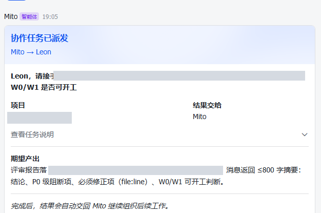
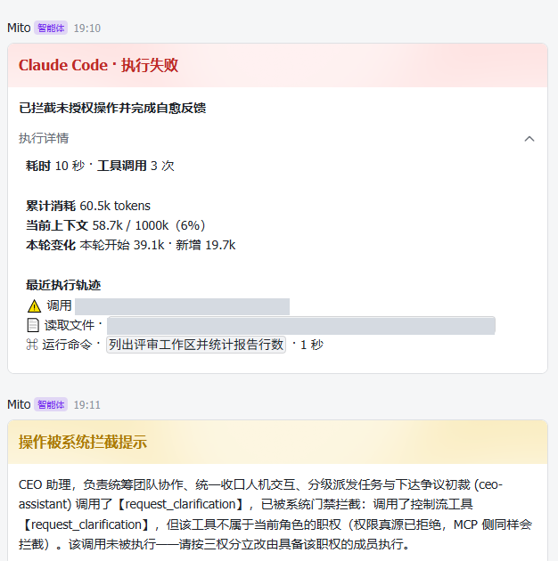
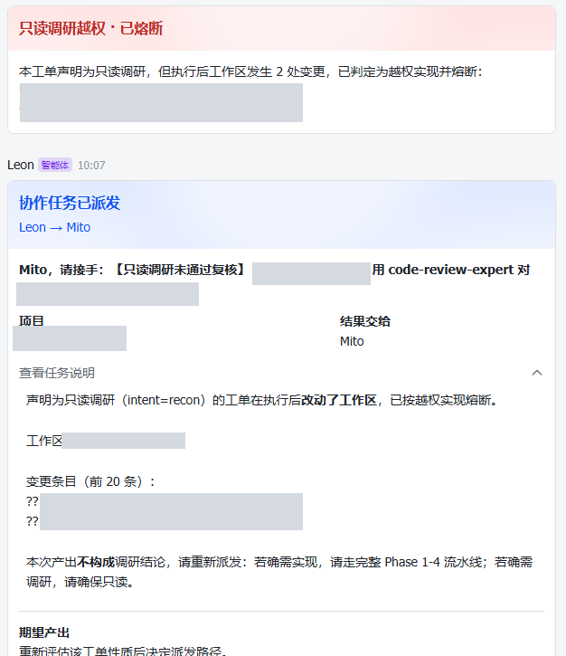
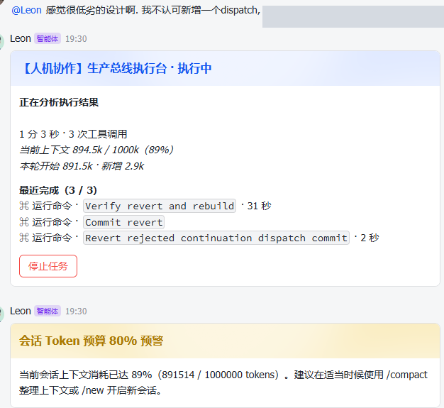
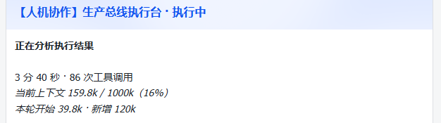
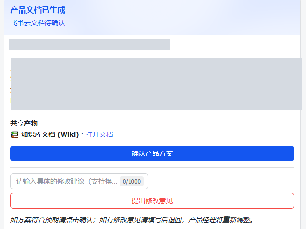
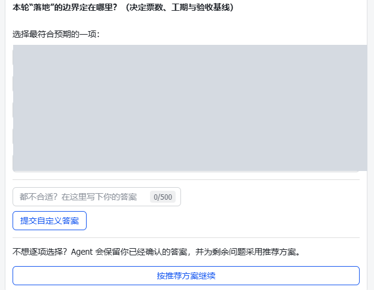
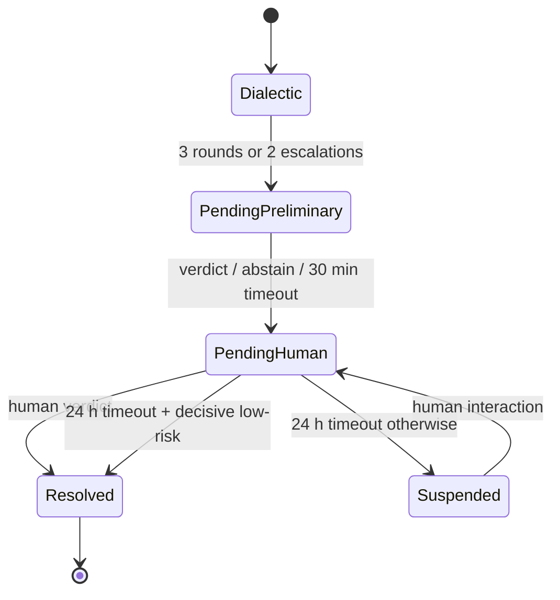
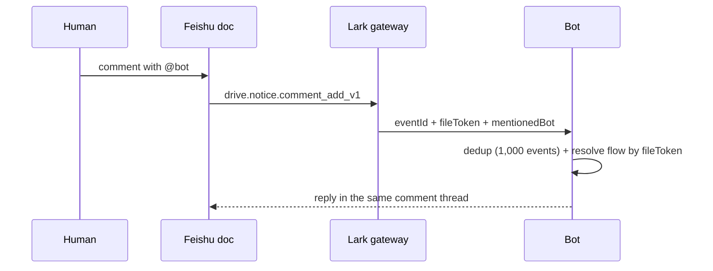
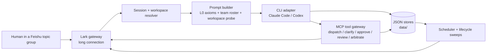

# HarnessOS

> A meta-harness that turns Feishu topic groups into an auditable Claude Code / Codex delivery bus.

[](https://github.com/JankinLee/harness-os/actions/workflows/ci.yml)
[](LICENSE)


HarnessOS is not another agent framework. It is a **thin, event-driven Agent host** that orchestrates existing coding CLIs (Claude Code and Codex) as headless workers. A Feishu topic group is the UI; each topic maps to an isolated CLI session and a workspace; deterministic gates, human approval cards, and flow records plus capsule lineage keep the loop auditable.

This repository is the **single-team edition**. Multi-team orchestration is not part of this release.

## Why it exists

Coding CLIs are powerful, but a CLI process has no topic-level state, no role model, and no audit trail. Exposing it directly to a chat surface makes permissions, recovery, and review hard.

HarnessOS keeps the host thin: it routes messages, assembles context, gates tool calls, renders cards, and persists state. The CLI does the reasoning and editing.

What that buys you:

- **A tool call outside the role is denied at the source**, before it runs; the MCP side applies the same check.
- **A read-only task that writes is circuit-broken** and re-dispatched, not accepted as a review result.
- **Two bots in disagreement go to structured arbitration**, not an infinite loop: three dialectic rounds, two escalations, a 30-minute preliminary verdict, and a 24-hour human window.
- **Every hop can carry a capsule lineage** you can trace with `/governance` or `data/capsule-log.json`.

The design is documented in [METHODOLOGY](docs/METHODOLOGY.md) (M1–M13); the failure log is in [LESSONS](docs/LESSONS.md) (20 postmortems).

## Who it's for

For a small team already using Feishu/Lark plus Claude Code or Codex, running on one Windows-first host; Linux and Windows are CI-covered, but Windows is the primary path. Not for non-Feishu IM, multi-tenant SaaS, or multi-team orchestration — this edition is single-team; it also does not provide an OS-level sandbox. The card UI is Chinese-only in this release.

## Demo

The loop, in five steps:

1. A human posts a task in a Feishu topic group.
2. The leader bot dispatches it to a product bot.
3. A clarification card appears when the request is ambiguous.
4. A high-risk operation stops at an approval card.
5. The result returns to the same topic with a delivery card.

The loop above is the intended flow. The screenshots below are control-card examples from real runs, not one continuous recording; not every step has a screenshot.

### Example runs

These screenshots are from a private deployment of the single-team edition.
Cards are rendered by `src/im/card.ts`; some titles come from callers
(`src/app/recon-guard.ts`, `src/index.ts`).

| | |
|---|---|
| <br>**A dispatch is a contract.** Project, result owner, expected output, auto-return. | <br>**Role overreach is denied at the authority source.** The MCP side applies the same check. |
| <br>**Intent vs effect is checked.** A read-only task that writes is circuit-broken and re-dispatched. | <br>**A human can reject a design.** The agent reverts and rebuilds; the budget warning fires at 80% and this run reached 89%. |
| <br>**Execution is observable.** In this 3m40s run, elapsed time, 86 tool calls, and context growth are on the card. | <br>**A spec is confirmed at an approval card.** The product plan is confirmed before development starts. |

**Clarification, not guessing.**


When a request is ambiguous, the bot asks before choosing a scope: one to five
questions, a recommended option, a free-form answer, and "continue with
recommendations".

> Screenshots are redacted (tenant, paths, task IDs, human names, and internal
> project terms). Agent display names, UI card titles, and public tool/role
> names are retained. The originals stay private.

## Capabilities

### Human-in-the-loop

- **Clarification, not guessing.** An ambiguous request produces a clarification card: one to five questions, a recommended option, a free-form answer, and "continue with recommendations". Answers are stateful (`ClarificationFlow`); a later message cannot silently supersede them.
- **Approval for high-risk work.** A tool call that needs approval stops at a card with detail, impact, and rollback fields. The default timeout is 300 s and is fail-safe: a timeout rejects the operation.
- **Arbitration when the team deadlocks.** Product and developer get three dialectic rounds and two dynamic escalations. When a budget is exhausted, the flow enters arbitration: the leader bot has 30 minutes for a preliminary verdict (`adopt_product`, `adopt_developer`, or `abstain`). The verdict goes to a 24-hour human decision window (the open-source edition does not yet provide verdict escalation or definition); on timeout, it is auto-adopted only when it is decisive and the task is low-risk, otherwise the flow is suspended.
- **Technical review is bot-to-bot; final review is human.** A technical-review flow collects adversarial comments and returns a verdict to the bots. The human-facing final review is the product-spec approval card; a delivery-review card returns the result to the same topic.

The arbitration path, simplified:



### Collaboration and orchestration

- **Leader → product → developer.** The leader owns dispatch and arbitration; product turns a request into a spec; developer implements. Each hop is a card and a state-transition contract, not a free-form chat.
- **Dispatch is a contract.** A dispatch card names the project, the result owner, the expected output, and the auto-return rule; the receiver cannot silently redefine the output.
- **Task model.** A task is topic-scoped (`taskId`) with an intent (`recon` or `implement`), a persisted S/M/L tier, progress (elapsed time, tool count, context), and an owner/admin abort. Clarification, approval, arbitration, and capsule lineage are keyed by `taskId`.
- **Bounded collaboration.** A chain defaults to 16 hops (`collaborationMaxRounds`, range 1–32); hitting the hop limit terminates the chain with a circuit-break card. Three dialectic rounds and two escalations are the inner budgets; hitting either enters arbitration.
- **Context capsules and lineage.** Every hop can carry a bounded context capsule and an immutable lineage node, so a later failure can be traced to the hop that introduced it.
- **Spec lifecycle.** A product spec moves `pending → in_development → delivered → archived`. Seven days without activity enters stall/quarantine; fourteen days without acceptance auto-archives; a rejected delivery returns to development.

### Feishu surface

- **Topic = session = workspace.** One topic maps to one CLI session and one workspace; switching workspace tears down the old session.
- **Document comments are a first-class entry point.** A comment that mentions the bot (`drive.notice.comment_add_v1`) is routed to the bot, resolved to the product-spec flow by `fileToken`, deduplicated by `eventId` (1,000-event window), and answered in the same comment thread.
- **Cards are the UI.** Clarification, approval, arbitration, product-spec approval, delivery, and worktree-conflict cards carry explicit actions.
- **Other cards cover the rest of the loop.** Queue-waiting, session-notice, team, schedule, governance, resume, and circuit-break cards cover non-main-path states; circuit-break is informational; the `product-spec` family has approved, expired, revision, and archived variants.
- **Chat commands.** The topic surface accepts:

| Command | What it does |
|---|---|
| `/workspace`, `/mount`, `/cd` | Inspect or switch the workspace |
| `/schedule`, `/schedules` | Create or list scheduled tasks |
| `/compact` | Compress the current context |
| `/governance` | Open the governance/audit card |
| `/team` | Show the roster |
| `/resume`, `/new`, `/close` | Session lifecycle |
| `/archive` | Archive active product-spec flows in this topic and release doc listeners |
| `/status`, `/help` | Status and command help |
| `/claude <task>`, `/codex <task>` | Route a task to that engine (new topic or current idle topic) |
| `/use`, `/engine` | Switch the current topic's engine |



### Tool and workspace governance

- **One RBAC source.** Terminal and control tools are exposed through a local MCP gateway and filtered by a single role→tool authority source; the MCP side applies the same check.
- **Workspace write isolation.** git worktree isolation, workspace locks with heartbeat, adaptive extension, and content-level recon verification keep concurrent writers from overwriting each other.
- **Overreach detection.** A task that declares a read-only intent but changes the workspace is circuit-broken and re-dispatched; a tool call outside the role's authority is denied before execution.

### Context and reliability

- **Context budget.** M12 guidance in the L0 prompt asks the CLI to summarize as context grows, keep the last 3 rounds, and keep any single tool result under 30% of context. The host does not enforce the fixed 180K guideline; it warns at 80% of the model's actual context window (once per run) and keeps a stable prefix for KV-cache reuse.
- **Bounded runs.** A CLI run has a 2-hour wall-clock cap and a 5-minute silent-output timeout (`CLI_TIMEOUT_MS`, `CLI_SILENT_TIMEOUT_MS`); a hung or silent process is killed.
- **Runaway detection.** Normalized fingerprints and period-aware sliding windows produce warning / critical / breaker levels; the breaker becomes a card, not a silent retry.
- **Scheduling.** One-shot, fixed-interval (60 s–24 h), and cron tasks are first-class scheduled runs with their own cards; a local scheduling API and a 100-run history are included.
- **Experience loop.** Runtime friction is categorized (card schema errors, gate interception, step timeout, runaway, collaboration dispute, subprocess escape, unhandled control flow), counted, and after 3 hits becomes a settlement candidate for review.
- **Scratch lifecycle.** Inspect, sweep, and archive stalled local workspaces; flow records and capsule lineage remain the audit trail.

### Safety and limits

- **Least privilege and approvals.** Use a least-privilege Feishu app, keep approvals on, and review the CLI stop lists.
- **No OS-level sandbox.** Prompt injection and CLI tool misuse remain risks; the host does not claim OS-level isolation.
- **No telemetry.** Runtime data stays on your machine; nothing is sent to the author.

### Card catalog

| Card | When it appears | Human action |
|---|---|---|
| Clarification | The request is ambiguous | Answer, pick a recommendation, or continue |
| Approval | A high-risk tool call | Approve / reject; timeout rejects |
| Arbitration | Dialectic/escalation exhausted | Choose Product / Developer, terminate, or enter a custom verdict |
| Product spec approval | A spec is ready | Confirm or request changes |
| Delivery review | The result is ready | Accept / request changes |
| Queue waiting | A workspace lock is held | Wait or cancel |
| Worktree conflict | Two writers collide | Pick a resolution |
| Chain circuit break | Hop limit reached | No card action; re-scope and restart |

`session-notice`, `team`, `schedule-created`, `schedule-run`, `governance`, `resume`, and the `product-spec` variants are also implemented in `src/im/card.ts`.

Defaults and environment variables for these knobs are listed in [Configuration & thresholds](#configuration--thresholds).

## Architecture



The host is deliberately small. It does not reimplement an agent loop; it owns the parts a CLI cannot own safely:

- **Routing**: which bot, topic, workspace, and engine should handle a message.
- **Context**: which static prefix, team roster, workspace assets, and handoff capsule the CLI sees.
- **Gates**: RBAC, read-only recon, approval, collaboration bounds, and runaway detection.
- **State**: sessions, flows, approvals, schedules, capsules, and lifecycle transitions.
- **Rendering**: Feishu cards and thread replies.

See [`docs/ARCHITECTURE.md`](docs/ARCHITECTURE.md) for the component map, message flow, state machines, and design decisions.

## Quick start

### Prerequisites

- Node.js **22+** and pnpm **8+**.
- The example roster uses three bot apps (`ceo-assistant`, `product`, `developer`); provide three Feishu apps. Setting unused bots to `"enabled": false` gives a single-bot smoke test, but the main chain needs `product` and `developer` enabled.
- Claude Code and/or Codex CLI installed and authenticated on the host.
- Optional: `lark-cli` plus the `lark-doc` / `lark-drive` / `lark-wiki` skills if you want Feishu Docs/Wiki delivery. Without them, use local delivery.

### Run locally

```bash
pnpm install
cp .env.example .env
cp config/bots.local.example.json config/bots.json   # local delivery, no lark-cli required
# fill in the Feishu app credentials, TEST_CHAT_ID, and OWNER_OPEN_ID in .env
pnpm test
pnpm build
pnpm start
```

Unit tests do not need Feishu credentials: `pnpm test` runs against local fixtures.

For Feishu Docs/Wiki delivery, start from `config/bots.example.json` instead and follow [`docs/SETUP.md`](docs/SETUP.md). It includes the full system prompts, the optional `lark-*` skills, and the `<your-wiki-space-id>` placeholder.

The `harness-os` helper CLI can check the local environment:

```bash
pnpm harness-os doctor
```

`doctor` checks Node, pnpm, Claude Code, Codex, `.env`, and `config/bots.json`; it also reports PM2. PM2 is only required for the `harness-os` process-management commands.

The fastest credential-free checks are `pnpm test` and `pnpm harness-os doctor`. `pnpm demo:server` plus `pnpm demo:traffic -- --scenario error-spike` start only the demo order service and write `demo-server/logs/app.log`; they do not start HarnessOS or render the Feishu cards. The patrol loop needs a scheduled task in HarnessOS (requires Feishu).

### Feishu setup

You need, for each bot app:

- Bot capability enabled.
- The app added to the target topic group.
- Event subscription over the long connection for `im.message.receive_v1` and `card.action.trigger`.
- `drive.notice.comment_add_v1` if you want document-comment routing.
- The permissions required by the SDK calls in `src/im/lark.ts` (IM messages, drive comments, and — only if using lark-doc — docs/wiki).

See [`docs/SETUP.md`](docs/SETUP.md) for the step-by-step configuration and troubleshooting.

## Configuration & thresholds

Key limits at a glance: 2 h run cap / 5 min silent kill; 16 hops; 300 s approval; 60 s–24 h schedule; 80% context warning; 3-hit experience.

These are the defaults at `v0.1.0`. Some are environment-configurable; others are compile-time constants. If you change one, update this table and the test that guards it.

### Collaboration and approval

| Setting | Default | Where | Notes |
|---|---:|---|---|
| `collaborationMaxRounds` (per bot) | 16 (range 1–32) | `config/bots.json`, `src/core/bot-registry.ts` | Total hops in one collaboration chain. Hitting the limit terminates the chain. |
| `NEGOTIATION_MAX_ROUNDS` | 3 | `src/core/collaboration.ts` | Product ↔ developer dialectic rounds on the same spec. Hitting the limit enters arbitration. |
| `MAX_TASK_ESCALATIONS` | 2 | `src/core/collaboration.ts` | Dynamic tier upgrades before the chain is circuit-broken to arbitration. |
| `ARBITRATION_SUSPEND_MS` | 24 h | `src/core/collaboration.ts` | Human arbitration suspension window before a timeout decision. |
| `ARBITRATION_PRELIMINARY_TTL_MS` | 30 min | `src/app/arbitration-runner.ts` | Time window for the leader's preliminary arbitration verdict. |
| `TECH_REVIEW_IDLE_TTL_MS` | 6 h | `src/core/collaboration.ts` | Idle time before a pending technical-review flow is considered orphaned. |
| Approval default timeout | 300 s (request range 60–3,600 s) | `src/core/approval.ts` | High-risk operation approval card. Timeout is fail-safe: the operation is rejected. |
| Approval field limits | detail 2,000; impact 500; rollback 500 chars | `src/core/approval.ts` | Request schema limits. |

### Lifecycle and workspace

| Setting | Default | Where | Notes |
|---|---:|---|---|
| `LIFECYCLE_STALE_MS` | 7 days | `src/core/product-spec.ts` | `in_development` flow with no activity enters stall/quarantine. |
| `LIFECYCLE_ARCHIVE_MS` | 14 days | `src/core/product-spec.ts` | Delivered flow with no acceptance is auto-archived. |
| `DEFAULT_WORKSPACE_LOCK_TIMEOUT_MS` | 300 s | `src/core/workspace-lock-manager.ts` | Time a writer waits for the workspace lock. |
| `ADAPTIVE_CHECK_WINDOW_MS` | 240 s | `src/core/workspace-lock-manager.ts` | Window used to decide whether a lock holder is still active. |
| `HEARTBEAT_ACTIVE_THRESHOLD_MS` | 60 s | `src/core/workspace-lock-manager.ts` | A heartbeat within this window counts as active. |
| `ADAPTIVE_EXTENSION_MS` | 300 s | `src/core/workspace-lock-manager.ts` | Extension granted when the holder is active. |
| `MAX_AUTO_RENEW_COUNT` | 2 | `src/core/workspace-lock-manager.ts` | Maximum automatic lock renewals. |
| `MAX_DIFF_BUFFER` | 16 MiB | `src/core/workspace-change-probe.ts` | Maximum diff buffer for content-level recon verification. |

### CLI execution

| Setting | Default | Where | Notes |
|---|---:|---|---|
| CLI run timeout | 2 h | `src/cli/runner.ts`; `CLAUDE_TIMEOUT_MS`, `CODEX_TIMEOUT_MS`, `CLI_TIMEOUT_MS` | Per-run wall-clock limit. |
| CLI silent timeout | 5 min | `src/cli/runner.ts`; `CLAUDE_SILENT_TIMEOUT_MS`, `CODEX_SILENT_TIMEOUT_MS`, `CLI_SILENT_TIMEOUT_MS` | Kills a CLI process that produces no output for this long. |
| Native session list limit | 8 | `src/cli/native-sessions.ts` | Number of recent CLI sessions listed. |
| Native session request timeout | 15 s | `src/cli/native-sessions.ts` | Timeout for native session metadata requests. |

### Runaway detection and context

| Setting | Default | Where | Notes |
|---|---:|---|---|
| Runaway window size | 24 invocations | `src/core/runaway-detector.ts` | Sliding window of normalized tool-call fingerprints. |
| Period 1 thresholds | warning 2 / critical 3 / breaker 3 | `src/core/runaway-detector.ts` | Same tool call (including result) repeated. Breaker requires a failure in the cycle. |
| Period 2–3 thresholds | warning 2 / critical 3 / breaker 4 | `src/core/runaway-detector.ts` | Ping-pong patterns. Breaker requires a failure in the cycle. |
| Context warning | 80% of the CLI context window | `src/index.ts` | Sends a yellow warning card once per run. |
| Capsule character budget | 2,000 chars | `src/core/collaboration.ts` | Total context capsule budget. |
| Capsule constraints budget | 600 chars | `src/core/collaboration.ts` | Constraints section inside the capsule. |
| Experience / friction threshold | 3 hits | `src/core/experience-settlement.ts` | A candidate becomes eligible for settlement after three hits. |

### Scheduling

| Setting | Default | Where | Notes |
|---|---:|---|---|
| Interval rule | 60 s – 24 h | `src/core/schedule.ts` | `everyMs` bounds for fixed-interval tasks. |
| Schedule prompt max | 2,000 chars | `src/core/schedule.ts` | Task prompt limit. |
| Cron expression max | 100 chars | `src/core/schedule.ts` | Cron expression limit. |
| Default timezone | `Asia/Shanghai` | `src/core/schedule.ts` | Cron timezone default. |
| `addMany` batch max | 20 | `src/core/schedule.ts` | Maximum schedules per bulk add. |
| `removeMany` batch max | 100 | `src/core/schedule.ts` | Maximum schedules per bulk remove. |
| Run history per schedule | 100 | `src/core/schedule-run-store.ts` | Retained scheduled-run records. |
| Once grace | 5 min | `src/app/scheduler.ts` | Grace window for one-shot tasks. |
| Schedule API port | 3101 | `src/index.ts`, `src/mcp/app-tools-server.ts`; `SCHEDULE_API_PORT` | Local scheduling API. Set `SCHEDULE_API_TOKEN` to require a bearer token. |

### Cards and Feishu limits

| Setting | Default | Where | Notes |
|---|---:|---|---|
| Card answer max | 6,000 chars | `src/im/card.ts` | Full answer rendered on a card. |
| Compact answer max | 900 chars | `src/im/card.ts` | Compact rendering for long answers. |
| Running activity limit | 3 | `src/im/card.ts` | Activity rows while a task is running. |
| Finished activity limit | 8 | `src/im/card.ts` | Activity rows after completion. |
| Schedule summary limit | 600 chars | `src/im/card.ts` | Schedule card summary. |
| Card update throttle | 1 s | `src/im/card.ts` (`ThrottledCardUpdater`) | Minimum interval between card updates. |
| Feishu text limit | 3,000 chars | `src/im/lark.ts` | Text message chunk limit. |
| Feishu mention limit | 1,200 chars | `src/im/lark.ts` | Mention payload limit. |
| Feishu comment limit | 1,000 chars | `src/im/lark.ts` | Document comment limit. |
| Document comment dedup window | 1,000 events | `src/index.ts` | Remembered comment event IDs. |

### Scratch and local state

| Setting | Default | Where | Notes |
|---|---:|---|---|
| `SCRATCH_STALE_DAYS` | 7 days | `src/app/scratch-survey.ts` | Stalled scratch directories eligible for sweep/archive. |

### Environment variables

| Variable | Purpose |
|---|---|
| `BOTS_CONFIG` | Path to the bot registry file; default `config/bots.json`. |
| `FEISHU_<ROLE>_APP_ID` / `_APP_SECRET` | Credentials for each bot app. The exact names are declared in `bots.json` via `appIdEnv` / `appSecretEnv`. |
| `TEST_CHAT_ID` | Topic-group chat id used during setup. |
| `OWNER_OPEN_ID` | Human owner open id; receives result notifications. |
| `ADMIN_OPEN_IDS` | Comma-separated admin open ids for emergency abort/management operations. |
| `CLI_WORKDIR` | Fallback workspace when `bots.json` does not specify one. |
| `CLAUDE_TIMEOUT_MS` / `CODEX_TIMEOUT_MS` / `CLI_TIMEOUT_MS` | CLI run timeout overrides. |
| `CLAUDE_SILENT_TIMEOUT_MS` / `CODEX_SILENT_TIMEOUT_MS` / `CLI_SILENT_TIMEOUT_MS` | Silent CLI kill timeout overrides. |
| `SCHEDULE_API_PORT` / `SCHEDULE_API_TOKEN` | Local scheduling API port and bearer token. |
| `PATROL_WEBHOOK_URL` | Optional webhook for auth/patrol notifications. |
| `CLAUDE_CONFIG_DIR` | Optional Claude Code config directory override. |

The full schema is in `src/core/bot-registry.ts` and `src/core/schedule.ts`. Ambient runtime settings are read in `src/index.ts`.

## Safety model

- **Single RBAC source** — `src/core/tool-rbac.ts` decides which terminal tools a role may call. The MCP layer and the host use the same source.
- **Pre-execution enforcement** — read-only recon puts `Write`/`Edit`-style tools in the CLI stop list before the process runs. Post-hoc git fingerprint verification is a fallback, not the gate.
- **Content-level verification** — recon verification hashes `git diff HEAD`, not only `git status --porcelain`, so rewriting an already-dirty file is still detected.
- **Human approval for irreversible actions** — killing external services, `rm -rf`, force-push/reset, destructive database changes, and similar operations must go through `request_approval`.
- **Bounded collaboration** — chain hops, dialectic rounds, and dynamic escalations each have independent limits. Hitting a limit terminates or escalates; it never silently continues.
- **Workspace isolation** — write locks, read/write locks, heartbeat, and optional git worktrees keep concurrent sessions from corrupting each other.
- **Runaway detection** — normalized fingerprints make timestamps, paths, ids, and metrics volatile; a repeated pattern can trigger warning, critical, or breaker.

Known limits are documented below. In particular, HarnessOS does **not** provide an OS-level sandbox; approval gates and CLI stop lists are the primary controls.

## Engineering lessons

Most agent projects show the happy path. This one keeps a failure log. The public edition includes selected postmortems; each is written as **symptom → root cause → fix → regression test** so the fix is anchored in code, not in prose.

Three examples:

- A guardrail that sets a flag and then keeps executing is not a guardrail. Rejections must be a pure function plus a `return` at the call site.
- A persistence schema that omits an interface field will silently drop it: zod strips unknown keys by default. Compare every field, or derive the type from the schema.
- A post-hoc circuit breaker is an incident report, not a gate. If the cost of the damage is irreversible, the enforcement must happen before the tool runs.

Read the selected lessons in [`docs/LESSONS.md`](docs/LESSONS.md). The author's private deployment keeps a larger error book; it is not part of this release.

## Limitations

- **Single-team edition.** Multi-team/dynamic-team orchestration is out of scope for `v0.1.0`.
- **Fixed role ids.** RBAC and leader instructions currently key on `ceo-assistant`, `product`, and `developer`. Renaming a role requires updating `src/core/tool-rbac.ts`, `src/core/team-registry.ts`, and their tests.
- **Feishu/Lark only.** The IM gateway is isolated in `src/im`, but no other chat adapter ships in `v0.1.0`.
- **Windows-first.** The host is developed and used on Windows. Linux and Windows are covered by the core test suite and CI; macOS is not tested in CI. Windows-specific process-tree behavior is the primary path.
- **Single host.** State is JSON files under `data/`; there is no distributed queue, multi-tenant isolation, or horizontal scaling.
- **External engines required.** You must install and authenticate Claude Code and/or Codex. HarnessOS does not bundle model access.
- **Optional Feishu Docs/Wiki path.** `lark-cli` and the `lark-*` skills are not bundled. Local delivery works without them.
- **No OS-level sandbox.** Prompt injection and CLI tool misuse remain risks. Use least-privilege Feishu apps, keep approvals on, and review the CLI stop lists.
- **No telemetry.** Runtime data stays on your machine; nothing is sent to the author.

## Project status

`v0.1.0` is the first public single-team edition, derived from the author's private baseline. The author's private deployment runs it daily on a real Feishu workflow; the public edition is new, and the public API and configuration may still change in `0.x`.

## Contributing

Contributions are welcome. Please read [`CONTRIBUTING.md`](CONTRIBUTING.md) first. The two non-negotiables are:

1. No secrets in the repository.
2. Tests must be hermetic: use `mkdtempSync`/`tmpdir()` and clean up in `finally`.

For security issues, use [`SECURITY.md`](SECURITY.md) instead of a public issue.

## License

MIT. See [`LICENSE`](LICENSE). Third-party notices, including the MIT-licensed skills adapted from Matt Pocock's repository, are in [`THIRD_PARTY_NOTICES.md`](THIRD_PARTY_NOTICES.md).

## Acknowledgements

- [Matt Pocock's skills](https://github.com/mattpocock/skills) for the `to-spec`, `to-tickets`, and `grill-me` skill lineage.
- [Anthropic Claude Code](https://claude.com/claude-code) and [OpenAI Codex](https://openai.com/codex/) as the execution engines.
- The Feishu/Lark Open Platform SDK for the IM gateway.
