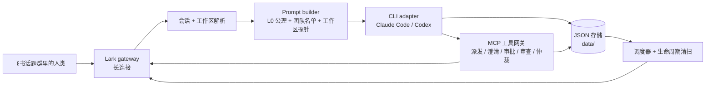

# HarnessOS

> 把飞书话题群变成可审计的 Claude Code / Codex 交付总线——一个 meta-harness。

[](https://github.com/JankinLee/harness-os/actions/workflows/ci.yml)
[](LICENSE)


HarnessOS 不是另一个 Agent 框架。它是一个**轻量、事件驱动的宿主**，把现成的编码 CLI（Claude Code 与 Codex）当作无头执行器来编排。飞书话题群是操作界面；一个话题对应一个隔离的 CLI 会话与一个工作区；确定性门禁、人工审批卡片和持久化流程日志让整条链路可审计。

本仓库是**单团队稳定版**。多团队/动态团队编排不在本版本范围内。

## 为什么需要它

- 编码 CLI 很强，但进程本身无状态。把它直接暴露给聊天界面，权限、恢复和审计都很难做。
- HarnessOS 保持宿主轻薄：只负责路由、组装上下文、门禁、渲染卡片和持久化状态；真正干活的是 CLI。
- 高危操作必须停在人工审批卡片上。只读调研在**执行前**就被强制，而不是事后报案。
- 每一次协作跳转都可以携带上下文胶囊和谱系节点，事后能定位是哪一跳引入了问题。

## 演示

一段 30–60 秒的录屏最快能说明问题：

1. 人类在飞书话题群发一条任务；
2. leader bot 把任务派发给 product bot；
3. 需求不清晰时出现澄清卡片；
4. 高危操作停在审批卡片；
5. 结果以交付卡片回到同一话题。

Demo GIF/视频会在首次公开发布时补充。在此之前，可以用 `pnpm demo:server` 在本地体验故障注入与日志巡检路径。

## 能力

- **飞书话题群即会话**：一个话题 = 一个 CLI 会话 = 一个工作区；切换工作区会冷销毁旧 CLI 会话。
- **Claude Code / Codex 适配器**：宿主与引擎解耦，两者共用同一套 MCP 工具契约。
- **MCP 工具网关**：终结型控制工具通过本地 MCP server 暴露，并由单一 RBAC 真源过滤。
- **人在环卡片**：澄清、审批、仲裁、技术审查、交付卡片都是独立状态机。
- **方案生命周期**：`pending → in_development → delivered → archived`，带停滞与归档清扫。
- **协作安全**：链跳数、辩证轮数、动态升级、仲裁与熔断彼此独立。
- **工作区隔离**：读写锁、心跳、自适应续期、git worktree 隔离、内容级 recon 复核。
- **失控检测**：归一化指纹、周期滑窗、warning/critical/breaker 分级。
- **上下文胶囊**：有界交接载荷 + 不可变谱系节点，便于审计。
- **定时任务**：一次性、固定间隔、cron。
- **Scratch 生命周期**：检查、清扫、归档停滞的本地工作区。

## 架构



宿主刻意保持小。它不重写 Agent loop，只负责 CLI 无法安全承担的部分：

- **路由**：哪条消息、哪个 bot、哪个工作区、哪个引擎。
- **上下文**：CLI 能看到什么静态前缀、团队名单、工作区资产和交接胶囊。
- **门禁**：RBAC、只读调研、审批、协作边界、失控检测。
- **状态**：会话、方案流、审批、调度、胶囊、生命周期。
- **渲染**：飞书卡片与话题回复。

更完整的组件图、消息流、状态机和设计取舍见 [`docs/ARCHITECTURE.md`](docs/ARCHITECTURE.md)。

## 快速开始

### 前置条件

- Node.js **22+** 与 pnpm **8+**。
- 至少一个开启机器人能力的飞书自建应用（每个 bot 一个应用是最简单的配置）。
- 本机已安装并登录 Claude Code 和/或 Codex CLI。
- 可选：`lark-cli` 与 `lark-doc` / `lark-drive` / `lark-wiki` skills。没有它们也能用 local 交付模式。

### 本地运行

```bash
pnpm install
cp .env.example .env
cp config/bots.local.example.json config/bots.json   # local 交付，不依赖 lark-cli
# 在 .env 中填入飞书应用凭证、TEST_CHAT_ID、OWNER_OPEN_ID
pnpm test
pnpm build
pnpm start
```

如果要使用飞书云文档/知识库交付，改为从 `config/bots.example.json` 开始，并按 [`docs/SETUP.md`](docs/SETUP.md) 配置。该示例包含完整系统提示词、可选 `lark-*` skills 和 `<your-wiki-space-id>` 占位符。

可以用内置 CLI 检查本机环境：

```bash
pnpm harness-os doctor
```

`doctor` 会检查 Node、pnpm、PM2、Claude Code、Codex、`.env` 与 `config/bots.json`。

### 飞书配置

每个 bot 应用需要：

- 开启机器人能力。
- 把应用拉进目标话题群。
- 通过长连接订阅 `im.message.receive_v1` 与 `card.action.trigger`。
- 如果需要云文档评论路由，再订阅 `drive.notice.comment_add_v1`。
- `src/im/lark.ts` 中 SDK 调用所需的权限（IM 消息、drive 评论；仅在使用 lark-doc 时需要 docs/wiki）。

完整步骤与排障见 [`docs/SETUP.md`](docs/SETUP.md)。

## 配置与阈值

以下是 `v0.1.0` 的默认值。部分可通过环境变量调整，部分是编译期常量。修改任何一项时，请同步本表与守护它的测试。

### 协作与审批

| 配置 | 默认值 | 位置 | 说明 |
|---|---:|---|---|
| `collaborationMaxRounds`（每个 bot） | 16（范围 1–32） | `config/bots.json`、`src/core/bot-registry.ts` | 一条协作链的总跳数上限；触顶终止整条链。 |
| `NEGOTIATION_MAX_ROUNDS` | 3 | `src/core/collaboration.ts` | product ↔ developer 就同一方案的辩证轮数；触顶进入仲裁。 |
| `MAX_TASK_ESCALATIONS` | 2 | `src/core/collaboration.ts` | 动态升级次数上限；超过则熔断转仲裁。 |
| `ARBITRATION_SUSPEND_MS` | 24 小时 | `src/core/collaboration.ts` | 人类仲裁挂起窗口。 |
| `ARBITRATION_PRELIMINARY_TTL_MS` | 30 分钟 | `src/app/arbitration-runner.ts` | leader 初裁结论的有效窗口。 |
| `TECH_REVIEW_IDLE_TTL_MS` | 6 小时 | `src/core/collaboration.ts` | 待审查流闲置多久视为孤儿。 |
| 审批默认超时 | 300 秒（请求范围 60–3,600 秒） | `src/core/approval.ts` | 高危审批卡片；超时 fail-safe 拒绝。 |
| 审批字段上限 | detail 2,000；impact 500；rollback 500 字符 | `src/core/approval.ts` | 请求 schema 限制。 |

### 生命周期与工作区

| 配置 | 默认值 | 位置 | 说明 |
|---|---:|---|---|
| `LIFECYCLE_STALE_MS` | 7 天 | `src/core/product-spec.ts` | `in_development` 流无活动则进入停滞/隔离。 |
| `LIFECYCLE_ARCHIVE_MS` | 14 天 | `src/core/product-spec.ts` | 已交付但无人验收则自动归档。 |
| `DEFAULT_WORKSPACE_LOCK_TIMEOUT_MS` | 300 秒 | `src/core/workspace-lock-manager.ts` | 写锁等待上限。 |
| `ADAPTIVE_CHECK_WINDOW_MS` | 240 秒 | `src/core/workspace-lock-manager.ts` | 判断锁持有者是否活跃的窗口。 |
| `HEARTBEAT_ACTIVE_THRESHOLD_MS` | 60 秒 | `src/core/workspace-lock-manager.ts` | 心跳在窗口内视为活跃。 |
| `ADAPTIVE_EXTENSION_MS` | 300 秒 | `src/core/workspace-lock-manager.ts` | 活跃时自动延长锁。 |
| `MAX_AUTO_RENEW_COUNT` | 2 | `src/core/workspace-lock-manager.ts` | 最大自动续期次数。 |
| `MAX_DIFF_BUFFER` | 16 MiB | `src/core/workspace-change-probe.ts` | recon 内容级复核的 diff 缓冲上限。 |

### CLI 执行

| 配置 | 默认值 | 位置 | 说明 |
|---|---:|---|---|
| CLI 单次超时 | 2 小时 | `src/cli/runner.ts`；`CLAUDE_TIMEOUT_MS`、`CODEX_TIMEOUT_MS`、`CLI_TIMEOUT_MS` | 每次 CLI 运行的墙钟上限。 |
| CLI 静默超时 | 5 分钟 | `src/cli/runner.ts`；`CLAUDE_SILENT_TIMEOUT_MS`、`CODEX_SILENT_TIMEOUT_MS`、`CLI_SILENT_TIMEOUT_MS` | 无输出超过该时长则强杀。 |
| 原生会话列表上限 | 8 | `src/cli/native-sessions.ts` | 最近列出的 CLI 会话数。 |
| 原生会话请求超时 | 15 秒 | `src/cli/native-sessions.ts` | 会话元数据请求超时。 |

### 失控检测与上下文

| 配置 | 默认值 | 位置 | 说明 |
|---|---:|---|---|
| 失控检测窗口 | 24 次调用 | `src/core/runaway-detector.ts` | 归一化工具调用指纹的滑窗。 |
| 周期 1 阈值 | warning 2 / critical 3 / breaker 3 | `src/core/runaway-detector.ts` | 同一工具调用（含结果）重复；breaker 需要周期内出现失败。 |
| 周期 2–3 阈值 | warning 2 / critical 3 / breaker 4 | `src/core/runaway-detector.ts` | 乒乓模式；breaker 需要周期内出现失败。 |
| 上下文预警 | CLI 上下文窗口的 80% | `src/index.ts` | 每个会话发送一次黄色预警卡。 |
| 胶囊字符预算 | 2,000 字符 | `src/core/collaboration.ts` | 上下文胶囊总预算。 |
| 胶囊约束预算 | 600 字符 | `src/core/collaboration.ts` | 胶囊内约束段预算。 |
| 经验/摩擦阈值 | 3 次 | `src/core/experience-settlement.ts` | 候选经验 3 次命中后进入可沉淀状态。 |

### 定时任务

| 配置 | 默认值 | 位置 | 说明 |
|---|---:|---|---|
| 固定间隔范围 | 60 秒 – 24 小时 | `src/core/schedule.ts` | `everyMs` 的上下限。 |
| 任务 prompt 上限 | 2,000 字符 | `src/core/schedule.ts` | 任务提示词长度。 |
| Cron 表达式上限 | 100 字符 | `src/core/schedule.ts` | Cron 表达式长度。 |
| 默认时区 | `Asia/Shanghai` | `src/core/schedule.ts` | Cron 时区默认值。 |
| 批量新增上限 | 20 | `src/core/schedule.ts` | `addMany` 单次上限。 |
| 批量删除上限 | 100 | `src/core/schedule.ts` | `removeMany` 单次上限。 |
| 每个任务的运行历史 | 100 条 | `src/core/schedule-run-store.ts` | 保留的调度运行记录。 |
| 一次性任务宽限 | 5 分钟 | `src/app/scheduler.ts` | 一次性任务的宽限窗口。 |
| 调度 API 端口 | 3101 | `src/index.ts`、`src/mcp/app-tools-server.ts`；`SCHEDULE_API_PORT` | 本地调度 API；设置 `SCHEDULE_API_TOKEN` 启用 bearer token。 |

### 卡片与飞书限制

| 配置 | 默认值 | 位置 | 说明 |
|---|---:|---|---|
| 卡片正文上限 | 6,000 字符 | `src/im/card.ts` | 完整答案在卡片上的长度。 |
| 紧凑答案上限 | 900 字符 | `src/im/card.ts` | 长答案的紧凑渲染。 |
| 运行中活动行 | 3 | `src/im/card.ts` | 运行中显示的活动行数。 |
| 完成后活动行 | 8 | `src/im/card.ts` | 完成后显示的活动行数。 |
| 调度摘要上限 | 600 字符 | `src/im/card.ts` | 调度卡片摘要长度。 |
| 卡片更新节流 | 1 秒 | `src/im/card.ts`（`ThrottledCardUpdater`） | 两次卡片更新的最小间隔。 |
| 飞书文本上限 | 3,000 字符 | `src/im/lark.ts` | 文本消息分片上限。 |
| 飞书 mention 上限 | 1,200 字符 | `src/im/lark.ts` | mention 载荷上限。 |
| 飞书评论上限 | 1,000 字符 | `src/im/lark.ts` | 云文档评论上限。 |
| 云文档评论去重窗口 | 1,000 个事件 | `src/index.ts` | 记住的评论事件 ID 数量。 |

### Scratch 与本地状态

| 配置 | 默认值 | 位置 | 说明 |
|---|---:|---|---|
| `SCRATCH_STALE_DAYS` | 7 天 | `src/app/scratch-survey.ts` | 停滞 scratch 目录可被清扫/归档的阈值。 |

### 环境变量

| 变量 | 用途 |
|---|---|
| `BOTS_CONFIG` | bot 注册文件路径；默认 `config/bots.json`。 |
| `FEISHU_<ROLE>_APP_ID` / `_APP_SECRET` | 每个 bot 应用的凭证；具体变量名由 `bots.json` 的 `appIdEnv` / `appSecretEnv` 声明。 |
| `TEST_CHAT_ID` | 配置期使用的测试话题群 chat id。 |
| `OWNER_OPEN_ID` | 人类 owner open id，接收结果通知。 |
| `ADMIN_OPEN_IDS` | 逗号分隔的管理员 open ids，用于紧急中止/管理操作。 |
| `CLI_WORKDIR` | `bots.json` 未指定工作区时的兜底目录。 |
| `CLAUDE_TIMEOUT_MS` / `CODEX_TIMEOUT_MS` / `CLI_TIMEOUT_MS` | CLI 运行超时覆盖。 |
| `CLAUDE_SILENT_TIMEOUT_MS` / `CODEX_SILENT_TIMEOUT_MS` / `CLI_SILENT_TIMEOUT_MS` | CLI 静默超时覆盖。 |
| `SCHEDULE_API_PORT` / `SCHEDULE_API_TOKEN` | 本地调度 API 端口与 bearer token。 |
| `PATROL_WEBHOOK_URL` | 可选的授权/巡检 webhook。 |
| `CLAUDE_CONFIG_DIR` | 可选的 Claude Code 配置目录覆盖。 |

完整 schema 见 `src/core/bot-registry.ts` 与 `src/core/schedule.ts`；运行时环境变量读取见 `src/index.ts`。

## 安全模型

- **单一 RBAC 真源**：`src/core/tool-rbac.ts` 决定角色能调用哪些终结工具；MCP 层与宿主共用同一份判定。
- **事前强制**：只读调研会在 CLI 启动前把 `Write`/`Edit` 类工具放进 stop 列表；事后 git 指纹复核只是兜底。
- **内容级复核**：recon 复核哈希 `git diff HEAD`，而不是只看 `git status --porcelain`；已有脏文件被再次改写也能发现。
- **不可逆操作人工审批**：杀外部服务、`rm -rf`、force-push/reset、破坏性数据库变更等必须走 `request_approval`。
- **有界协作**：链跳数、辩证轮数、动态升级各自独立限额；触顶就终止或升级，绝不静默继续。
- **工作区隔离**：写锁、读写锁、心跳、可选 git worktree，避免并发会话互相污染。
- **失控检测**：归一化指纹把时间戳、路径、id、指标视为波动值；重复模式可触发 warning/critical/breaker。

已知边界见下文。特别说明：HarnessOS **不提供 OS 级沙箱**；审批门禁与 CLI stop 列表是主要控制手段。

## 工程失败学

大多数 Agent 项目展示成功路径；这里保留失败日志。公开版收录精选复盘，每条都写成 **现象 → 根因 → 修复 → 回归测试**，让修复锚定在代码而不是散文里。

三个例子：

- 护栏如果只是设一个标志位然后继续执行，它就不是护栏。拒绝必须是纯函数 + 调用点 `return`。
- 持久化 schema 漏掉 interface 字段时，zod 默认会静默剥离未知键。必须逐字段比对，或直接用 schema 推导类型。
- 事后熔断不是门禁，是报案。如果破坏不可逆，强制必须发生在工具执行之前。

精选条目见 [`docs/LESSONS.md`](docs/LESSONS.md)。作者的私有部署保留了更大的错题本，不在本版本中。

## 已知边界

- **单团队版**：本版本之后开发的多团队/动态团队编排不在其中。
- **角色 ID 固定**：RBAC 与 leader 指令目前锚定 `ceo-assistant`、`product`、`developer`。重命名角色需要同步修改 `src/core/tool-rbac.ts`、`src/core/team-registry.ts` 及其测试。
- **仅飞书/Lark**：IM 网关隔离在 `src/im`，但 `v0.1.0` 没有其他聊天适配器。
- **Windows 优先**：宿主主要在 Windows 上开发和日常使用；核心测试与 CI 覆盖 Linux/macOS，但 Windows 进程树行为是主路径。
- **单机**：状态是 `data/` 下的 JSON 文件；没有分布式队列、多租户隔离或水平扩展。
- **依赖外部引擎**：必须自行安装并登录 Claude Code 和/或 Codex；HarnessOS 不附带模型访问。
- **飞书云文档/知识库路径可选**：`lark-cli` 与 `lark-*` skills 不随仓分发；local 交付不依赖它们。
- **无 OS 级沙箱**：prompt injection 与 CLI 工具滥用仍是风险。请使用最小权限的飞书应用、保持审批开启，并审查 CLI stop 列表。
- **无遥测**：运行时数据留在本机，不会发送给作者。

## 项目状态

`v0.1.0` 是首个公开的单团队稳定版，来自作者的私有稳定基线。它已在真实飞书工作流上日常使用，但公开 API 与配置在 `0.x` 阶段仍可能变化。

计划中的工作（不构成承诺）：

- 多团队编排。
- 更多 IM 适配器。
- 更强的沙箱与出站控制。
- 无需凭证的本地 mock 飞书适配器。

## 贡献

欢迎贡献。请先读 [`CONTRIBUTING.md`](CONTRIBUTING.md)。两条不可协商的规则：

1. 仓库中不得出现任何密钥。
2. 测试必须密闭：用 `mkdtempSync`/`tmpdir()` 创建临时目录，并在 `finally` 中清理。

安全问题请按 [`SECURITY.md`](SECURITY.md) 私下报告，不要开公开 issue。

## 许可证

MIT，见 [`LICENSE`](LICENSE)。第三方声明（包括改编自 Matt Pocock 仓库的 MIT skills）见 [`THIRD_PARTY_NOTICES.md`](THIRD_PARTY_NOTICES.md)。

## 致谢

- [Matt Pocock's skills](https://github.com/mattpocock/skills)：`to-spec`、`to-tickets`、`grill-me` 的 skill 谱系。
- [Anthropic Claude Code](https://claude.com/claude-code) 与 [OpenAI Codex](https://openai.com/codex/)：执行引擎。
- 飞书/Lark 开放平台 SDK：IM 网关。
