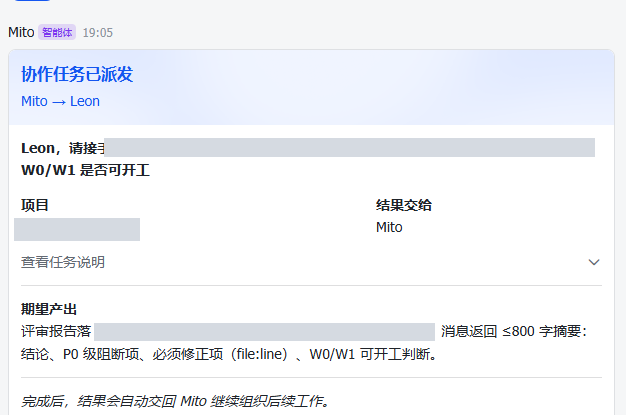
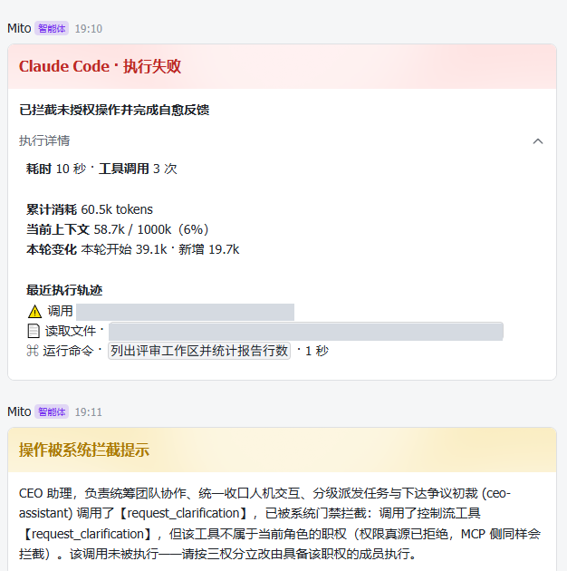
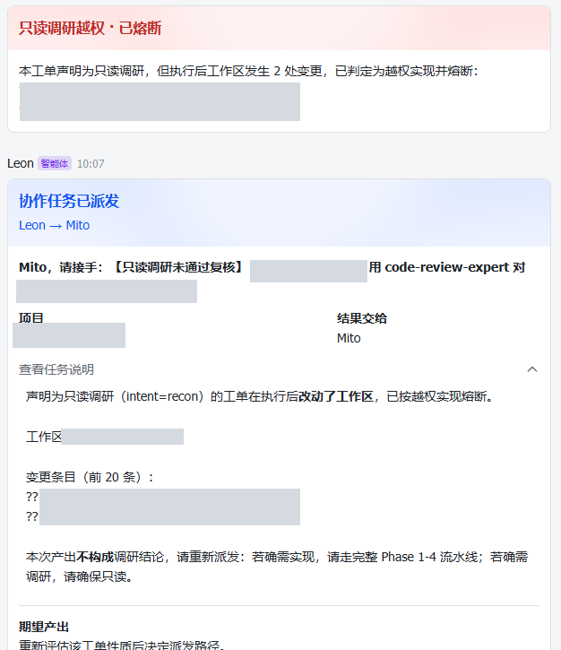
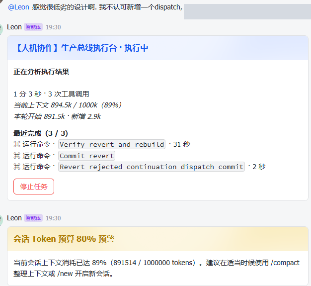
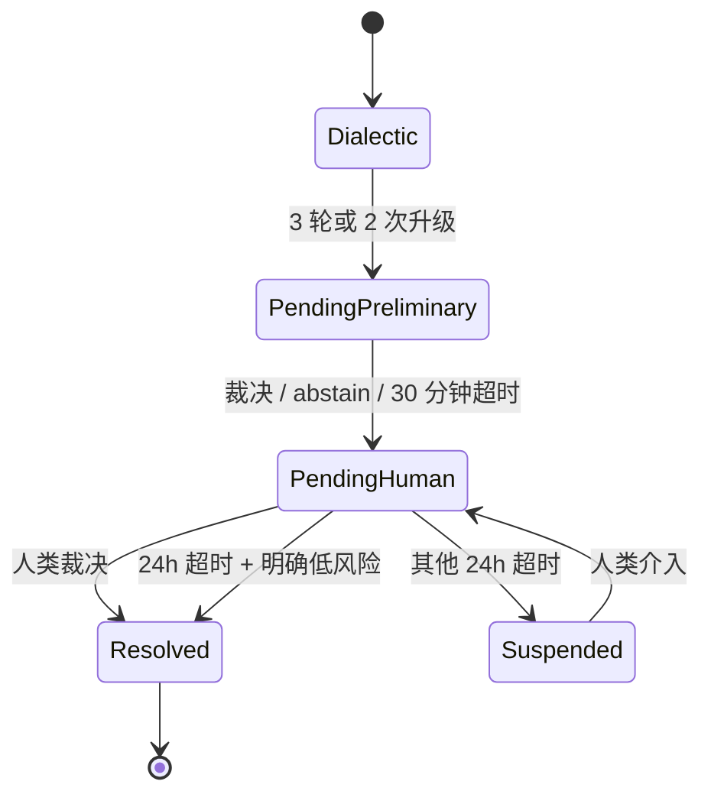
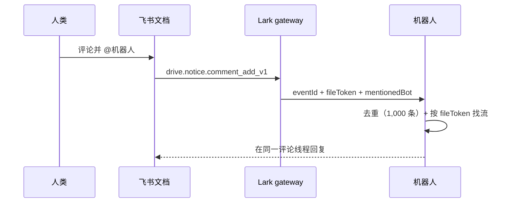
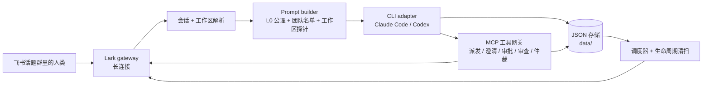

# HarnessOS

> 把飞书话题群变成可审计的 Claude Code / Codex 交付总线——一个 meta-harness。

[](https://github.com/JankinLee/harness-os/actions/workflows/ci.yml)
[](LICENSE)


HarnessOS 不是另一个 Agent 框架。它是一个**轻量、事件驱动的Agent宿主**，把现成的编码 CLI（Claude Code 与 Codex）当作无头执行器来编排。飞书话题群是操作界面；一个话题对应一个隔离的 CLI 会话与一个工作区；确定性门禁、人工审批卡片、流程记录与胶囊谱系让整条链路可审计。

本仓库是**单团队版**。多团队/动态团队编排不在本版本范围内。

## 为什么需要它

编码 CLI 很强，但一个 CLI 进程没有话题级状态、没有角色模型、也没有审计链。把它直接暴露给聊天界面，权限、恢复和评审都很难做。

HarnessOS 保持宿主轻薄：只负责路由、组装上下文、门禁、渲染卡片和持久化状态；真正干活的是 CLI。

它具体带来什么：

- **越权工具在源头被拒绝**，在它执行之前；MCP 侧共用同一份判定。
- **声明只读却写入的任务会熔断**并重新派发，不会被当作评审结论。
- **两个 bot 僵持时进入结构化仲裁**，而不是无限循环：3 轮辩证、2 次升级、30 分钟初裁、24 小时人类窗口。
- **每一跳都可以带胶囊谱系**，可以用 `/governance` 或 `data/capsule-log.json` 追。

设计文档在 [METHODOLOGY](docs/METHODOLOGY.md)（M1–M13）；失败日志在 [LESSONS](docs/LESSONS.md)（20 篇复盘）。

## 适合谁

适合已经在用飞书/Lark + Claude Code 或 Codex、单机部署（Windows 优先，Linux/Windows 有 CI 覆盖）的小团队。不适合非飞书 IM、多租户 SaaS 或多团队编排——本版本是单团队版；它也不提供 OS 级沙箱。卡片 UI 目前是中文。

## 演示

五步循环：

1. 人类在飞书话题群发一条任务；
2. leader bot 把任务派发给 product bot；
3. 需求不清晰时出现澄清卡片；
4. 高危操作停在审批卡片；
5. 结果以交付卡片回到同一话题。

上面的五步是目标流程。下面的截图是真实运行中的控制卡片，不是一次连续录屏；也不是每一步都有截图。

### 运行示例

以下截图来自单团队版的私有部署。卡片由 `src/im/card.ts` 渲染，部分标题由调用方传入
（`src/app/recon-guard.ts`、`src/index.ts`）。

| | |
|---|---|
| <br>**派发是契约。** 项目、结果交给谁、期望产出、自动交回。 | <br>**角色越权在权限真源被拒绝。** MCP 侧共用同一份判定。 |
| <br>**意图与效果不一致会被检查。** 声明只读却写入，熔断并重新派发。 | <br>**人可以否决设计。** agent 回退并重建；预算预警阈值 80%，本次运行到 89%。 |
| <br>**任务执行可观测。** 这次 3 分 40 秒的运行里，耗时、86 次工具调用、上下文增长都在卡片上。 | <br>**方案在审批卡确认。** 产品方案确认后才进入开发。 |

**澄清而不是猜。**


需求不明确时，机器人先问再选：1–5 个问题、一个推荐项、自由填写答案，以及“按推荐方案继续”。

> 截图已脱敏（租户、路径、任务号、人名、内部项目术语）；智能体显示名、UI 卡片标题、公开工具/角色名保留。原图不公开。

## 能力

### 人机协作

- **澄清而不是猜。** 需求不明确时，机器人先发澄清卡片：1–5 个问题、一个推荐项、自由填写答案，以及“按推荐方案继续”。回答是有状态的（`ClarificationFlow`），后续消息不能静默覆盖。
- **高危操作走审批。** 需要审批的工具调用停在审批卡：detail / impact / rollback 三个字段。默认 300 秒超时，超时即拒绝（fail-safe）。
- **僵局进仲裁。** product 与 developer 先走 3 轮辩证、最多 2 次动态升级；任一预算用尽后进入仲裁：leader 机器人在 30 分钟内给初裁（`adopt_product`、`adopt_developer`、`abstain`）。初裁进入 24 小时人类决策窗口(开源版暂不提供裁定上升/界定能力)；超时后仅当裁决明确且任务低风险时自动采纳，否则转入停滞休眠。
- **技术评审是 bot-to-bot，最终评审由人做。** 技术评审流收集对抗意见并把结论回给机器人；人类侧的最终评审是方案审批卡（产品文档已生成 / 确认或提修改意见），交付验收卡把结果带回同一话题。

仲裁路径（简化）：



### 协作与编排

- **leader → product → developer。** leader 负责派发与仲裁；product 把需求变成方案；developer 实现。每一跳都是卡片和状态迁移的契约，不是自由聊天。
- **派发是契约。** 派发卡写明项目、结果交给谁、期望产出、自动交回规则；接收方不能静默改写产出。
- **任务模型。** 任务是话题级的（`taskId`），带意图（`recon` 或 `implement`）、持久化的 S/M/L 分级、进度（耗时、工具数、上下文）和 owner/admin 中止；澄清、审批、仲裁与胶囊谱系都按 `taskId` 关联。
- **协作有界。** 一条链默认 16 跳（`collaborationMaxRounds`，范围 1–32）；跳数触顶会熔断终止整条链并出 circuit-break 卡。辩证 3 轮、升级 2 次是内层预算，任一触顶进入仲裁。
- **上下文胶囊与谱系。** 每一跳都可携带一个有界上下文胶囊和一个不可变谱系节点，事后能定位是哪一跳引入了问题。
- **方案生命周期。** 方案走 `pending → in_development → delivered → archived`；7 天无活动进入停滞/隔离，14 天未验收自动归档，验收被拒会退回开发。

### 飞书界面

- **话题 = 会话 = 工作区。** 一个话题对应一个 CLI 会话和一个工作区；切换工作区会冷销毁旧会话。
- **文档评论是一等入口。** 提到机器人的评论（`drive.notice.comment_add_v1`）会路由到机器人，按 `fileToken` 找到方案流，按 `eventId` 去重（1,000 条窗口），并回到同一评论线程回复。
- **卡片就是 UI。** 澄清、审批、仲裁、方案审批、交付、worktree 冲突卡都带明确动作。
- **其余卡片覆盖剩余的环路。** 排队等待、会话通知、团队、定时任务、治理、恢复、链熔断卡覆盖非主路径状态；链熔断卡是通知性的；`product-spec` 还有已批准、已过期、修订、已归档等变体。
- **聊天命令。** 话题里支持：

| 命令 | 作用 |
|---|---|
| `/workspace`、`/mount`、`/cd` | 查看或切换工作区 |
| `/schedule`、`/schedules` | 创建或列出定时任务 |
| `/compact` | 压缩当前上下文 |
| `/governance` | 打开治理/审计卡 |
| `/team` | 查看 roster |
| `/resume`、`/new`、`/close` | 会话生命周期 |
| `/archive` | 归档当前话题的活动方案流，并释放云文档监听 |
| `/status`、`/help` | 状态与命令帮助 |
| `/claude <task>`、`/codex <task>` | 把任务路由到该引擎（新话题或当前空闲话题） |
| `/use`、`/engine` | 切换当前话题的引擎 |



### 工具与工作区治理

- **单一 RBAC 真源。** 终结型与控制工具通过本地 MCP 网关暴露，由唯一的“角色→工具”真源过滤；MCP 侧共用同一份判定。
- **工作区写入隔离。** git worktree 隔离、工作区锁 + 心跳、自适应续期、内容级 recon 复核，避免并发写互相覆盖。
- **越权检测。** 声明只读却改了工作区，会熔断并重新派发；角色调用职权外的工具会在执行前被拒绝。

### 上下文与可靠性

- **上下文预算。** L0 prompt 中的 M12 指引要求 CLI 随上下文增长做摘要、保留最近 3 轮、单个工具结果不超过 30%；宿主不执行固定的 180K 阈值，只在模型实际上下文窗口的 80% 时每次运行发一次预警，并保持稳定前缀以复用 KV Cache。
- **运行时长上限。** CLI 单次运行有 2 小时墙钟上限和 5 分钟无输出超时（`CLI_TIMEOUT_MS`、`CLI_SILENT_TIMEOUT_MS`）；挂起或静默的进程会被杀掉。
- **失控检测。** 归一化指纹 + 周期滑窗，输出 warning / critical / breaker；breaker 落成卡片，而不是静默重试。
- **定时任务。** 一次性、固定间隔（60 秒–24 小时）、cron 都是独立调度，配有各自卡片；带本地调度 API 和 100 条运行历史。
- **经验回路。** 运行摩擦会按类别沉淀（卡片 schema 错误、门禁拦截、步骤超时、失控、协作争议、子进程逃逸、控制流未处理），计次到 3 次成为待评审候选。
- **Scratch 生命周期。** 检查、清扫、归档停滞的本地工作区；流程记录与胶囊谱系保留审计线索。

### 安全与边界

- **最小权限 + 审批。** 使用最小权限的飞书应用，保持审批开启，并审查 CLI stop 列表。
- **无 OS 级沙箱。** Prompt injection 与 CLI 工具滥用仍是风险；宿主不声称 OS 级隔离。
- **无遥测。** 运行数据留在本机，不会发送给作者。

### 卡片目录

| 卡片 | 何时出现 | 人的动作 |
|---|---|---|
| 澄清 | 需求不明确 | 回答、选推荐、或继续 |
| 审批 | 高危工具调用 | 通过 / 拒绝；超时即拒绝 |
| 仲裁 | 辩证/升级预算用尽 | 选 Product / Developer、终止，或填写自定义裁决 |
| 方案审批 | 方案就绪 | 确认或提修改意见 |
| 交付验收 | 结果就绪 | 验收 / 要求修改 |
| 排队等待 | 工作区锁被占用 | 等待或取消 |
| worktree 冲突 | 两个写者相撞 | 选择解决方式 |
| 链熔断 | 跳数触顶 | 无卡片按钮；缩小范围重启 |

`session-notice`、`team`、`schedule-created`、`schedule-run`、`governance`、`resume` 以及 `product-spec` 的其它变体也在 `src/im/card.ts` 中实现。

这些开关的默认值与环境变量见 [配置与阈值](#配置与阈值)。

## 架构



宿主刻意保持小。它不重写 Agent loop，只负责 CLI 无法安全承担的部分：

- **路由**：哪条消息、哪个 bot、哪个工作区、哪个引擎。
- **上下文**：CLI 能看到什么静态前缀、团队名单、工作区资产和交接胶囊。
- **门禁**：RBAC、只读调研、审批、协作边界、失控检测。
- **状态**：会话、方案流、审批、调度、胶囊、生命周期。
- **渲染**：飞书卡片与话题回复。

更完整的组件图、消息流、状态机和设计取舍见 [`docs/ARCHITECTURE.md`](docs/ARCHITECTURE.md)。

## 快速开始

### 前置条件

- Node.js **22+** 与 pnpm **8+**。
- 示例 roster 使用三个 bot 应用（`ceo-assistant`、`product`、`developer`）；准备三个飞书应用。把不用的 bot 设为 `"enabled": false` 只能做单 bot 冒烟；主链路需要 `product` 与 `developer` 都启用。
- 本机已安装并登录 Claude Code 和/或 Codex CLI。
- 可选：`lark-cli` 与 `lark-doc` / `lark-drive` / `lark-wiki` skills。没有它们也能用 local 交付模式。

### 本地运行

```bash
pnpm install
cp .env.example .env
cp config/bots.local.example.json config/bots.json   # local 交付，不依赖 lark-cli
# 在 .env 中填入飞书应用凭证、TEST_CHAT_ID、OWNER_OPEN_ID
pnpm test
pnpm build
pnpm start
```

单元测试不需要飞书凭证：`pnpm test` 使用本地 fixture。

如果要使用飞书云文档/知识库交付，改为从 `config/bots.example.json` 开始，并按 [`docs/SETUP.md`](docs/SETUP.md) 配置。该示例包含完整系统提示词、可选 `lark-*` skills 和 `<your-wiki-space-id>` 占位符。

可以用内置 CLI 检查本机环境：

```bash
pnpm harness-os doctor
```

`doctor` 会检查 Node、pnpm、Claude Code、Codex、`.env` 与 `config/bots.json`，也会报告 PM2；只有 `harness-os` 的进程管理命令需要 PM2。

最快的免凭证检查是 `pnpm test` 与 `pnpm harness-os doctor`。`pnpm demo:server` 加 `pnpm demo:traffic -- --scenario error-spike` 只启动演示订单服务并写 `demo-server/logs/app.log`；它不会启动 HarnessOS，也不渲染飞书卡片。巡检回路需要在 HarnessOS 里注册定时任务（需要飞书）。

### 飞书配置

每个 bot 应用需要：

- 开启机器人能力。
- 把应用拉进目标话题群。
- 通过长连接订阅 `im.message.receive_v1` 与 `card.action.trigger`。
- 如果需要云文档评论路由，再订阅 `drive.notice.comment_add_v1`。
- `src/im/lark.ts` 中 SDK 调用所需的权限（IM 消息、drive 评论；仅在使用 lark-doc 时需要 docs/wiki）。

完整步骤与排障见 [`docs/SETUP.md`](docs/SETUP.md)。

## 配置与阈值

关键上限一览：2 小时运行上限 / 5 分钟静默强杀；16 跳；300 秒审批；60 秒–24 小时调度；80% 上下文预警；3 次经验沉淀。

以下是 `v0.1.0` 的默认值。部分可通过环境变量调整，部分是编译期常量。修改任何一项时，请同步本表与守护它的测试。

### 协作与审批

| 配置 | 默认值 | 位置 | 说明 |
|---|---:|---|---|
| `collaborationMaxRounds`（每个 bot） | 16（范围 1–32） | `config/bots.json`、`src/core/bot-registry.ts` | 一条协作链的总跳数上限；触顶终止整条链。 |
| `NEGOTIATION_MAX_ROUNDS` | 3 | `src/core/collaboration.ts` | product ↔ developer 就同一方案的辩证轮数；触顶进入仲裁。 |
| `MAX_TASK_ESCALATIONS` | 2 | `src/core/collaboration.ts` | 动态升级次数上限；超过则熔断转仲裁。 |
| `ARBITRATION_SUSPEND_MS` | 24 小时 | `src/core/collaboration.ts` | 人类仲裁挂起窗口。 |
| `ARBITRATION_PRELIMINARY_TTL_MS` | 30 分钟 | `src/app/arbitration-runner.ts` | leader 初裁结论的有效窗口。 |
| `TECH_REVIEW_IDLE_TTL_MS` | 6 小时 | `src/core/collaboration.ts` | 待审查流闲置多久视为孤儿。 |
| 审批默认超时 | 300 秒（请求范围 60–3,600 秒） | `src/core/approval.ts` | 高危审批卡片；超时 fail-safe 拒绝。 |
| 审批字段上限 | detail 2,000；impact 500；rollback 500 字符 | `src/core/approval.ts` | 请求 schema 限制。 |

### 生命周期与工作区

| 配置 | 默认值 | 位置 | 说明 |
|---|---:|---|---|
| `LIFECYCLE_STALE_MS` | 7 天 | `src/core/product-spec.ts` | `in_development` 流无活动则进入停滞/隔离。 |
| `LIFECYCLE_ARCHIVE_MS` | 14 天 | `src/core/product-spec.ts` | 已交付但无人验收则自动归档。 |
| `DEFAULT_WORKSPACE_LOCK_TIMEOUT_MS` | 300 秒 | `src/core/workspace-lock-manager.ts` | 写锁等待上限。 |
| `ADAPTIVE_CHECK_WINDOW_MS` | 240 秒 | `src/core/workspace-lock-manager.ts` | 判断锁持有者是否活跃的窗口。 |
| `HEARTBEAT_ACTIVE_THRESHOLD_MS` | 60 秒 | `src/core/workspace-lock-manager.ts` | 心跳在窗口内视为活跃。 |
| `ADAPTIVE_EXTENSION_MS` | 300 秒 | `src/core/workspace-lock-manager.ts` | 活跃时自动延长锁。 |
| `MAX_AUTO_RENEW_COUNT` | 2 | `src/core/workspace-lock-manager.ts` | 最大自动续期次数。 |
| `MAX_DIFF_BUFFER` | 16 MiB | `src/core/workspace-change-probe.ts` | recon 内容级复核的 diff 缓冲上限。 |

### CLI 执行

| 配置 | 默认值 | 位置 | 说明 |
|---|---:|---|---|
| CLI 单次超时 | 2 小时 | `src/cli/runner.ts`；`CLAUDE_TIMEOUT_MS`、`CODEX_TIMEOUT_MS`、`CLI_TIMEOUT_MS` | 每次 CLI 运行的墙钟上限。 |
| CLI 静默超时 | 5 分钟 | `src/cli/runner.ts`；`CLAUDE_SILENT_TIMEOUT_MS`、`CODEX_SILENT_TIMEOUT_MS`、`CLI_SILENT_TIMEOUT_MS` | 无输出超过该时长则强杀。 |
| 原生会话列表上限 | 8 | `src/cli/native-sessions.ts` | 最近列出的 CLI 会话数。 |
| 原生会话请求超时 | 15 秒 | `src/cli/native-sessions.ts` | 会话元数据请求超时。 |

### 失控检测与上下文

| 配置 | 默认值 | 位置 | 说明 |
|---|---:|---|---|
| 失控检测窗口 | 24 次调用 | `src/core/runaway-detector.ts` | 归一化工具调用指纹的滑窗。 |
| 周期 1 阈值 | warning 2 / critical 3 / breaker 3 | `src/core/runaway-detector.ts` | 同一工具调用（含结果）重复；breaker 需要周期内出现失败。 |
| 周期 2–3 阈值 | warning 2 / critical 3 / breaker 4 | `src/core/runaway-detector.ts` | 乒乓模式；breaker 需要周期内出现失败。 |
| 上下文预警 | CLI 上下文窗口的 80% | `src/index.ts` | 每次运行发送一次黄色预警卡。 |
| 胶囊字符预算 | 2,000 字符 | `src/core/collaboration.ts` | 上下文胶囊总预算。 |
| 胶囊约束预算 | 600 字符 | `src/core/collaboration.ts` | 胶囊内约束段预算。 |
| 经验/摩擦阈值 | 3 次 | `src/core/experience-settlement.ts` | 候选经验 3 次命中后进入可沉淀状态。 |

### 定时任务

| 配置 | 默认值 | 位置 | 说明 |
|---|---:|---|---|
| 固定间隔范围 | 60 秒 – 24 小时 | `src/core/schedule.ts` | `everyMs` 的上下限。 |
| 任务 prompt 上限 | 2,000 字符 | `src/core/schedule.ts` | 任务提示词长度。 |
| Cron 表达式上限 | 100 字符 | `src/core/schedule.ts` | Cron 表达式长度。 |
| 默认时区 | `Asia/Shanghai` | `src/core/schedule.ts` | Cron 时区默认值。 |
| 批量新增上限 | 20 | `src/core/schedule.ts` | `addMany` 单次上限。 |
| 批量删除上限 | 100 | `src/core/schedule.ts` | `removeMany` 单次上限。 |
| 每个任务的运行历史 | 100 条 | `src/core/schedule-run-store.ts` | 保留的调度运行记录。 |
| 一次性任务宽限 | 5 分钟 | `src/app/scheduler.ts` | 一次性任务的宽限窗口。 |
| 调度 API 端口 | 3101 | `src/index.ts`、`src/mcp/app-tools-server.ts`；`SCHEDULE_API_PORT` | 本地调度 API；设置 `SCHEDULE_API_TOKEN` 启用 bearer token。 |

### 卡片与飞书限制

| 配置 | 默认值 | 位置 | 说明 |
|---|---:|---|---|
| 卡片正文上限 | 6,000 字符 | `src/im/card.ts` | 完整答案在卡片上的长度。 |
| 紧凑答案上限 | 900 字符 | `src/im/card.ts` | 长答案的紧凑渲染。 |
| 运行中活动行 | 3 | `src/im/card.ts` | 运行中显示的活动行数。 |
| 完成后活动行 | 8 | `src/im/card.ts` | 完成后显示的活动行数。 |
| 调度摘要上限 | 600 字符 | `src/im/card.ts` | 调度卡片摘要长度。 |
| 卡片更新节流 | 1 秒 | `src/im/card.ts`（`ThrottledCardUpdater`） | 两次卡片更新的最小间隔。 |
| 飞书文本上限 | 3,000 字符 | `src/im/lark.ts` | 文本消息分片上限。 |
| 飞书 mention 上限 | 1,200 字符 | `src/im/lark.ts` | mention 载荷上限。 |
| 飞书评论上限 | 1,000 字符 | `src/im/lark.ts` | 云文档评论上限。 |
| 云文档评论去重窗口 | 1,000 个事件 | `src/index.ts` | 记住的评论事件 ID 数量。 |

### Scratch 与本地状态

| 配置 | 默认值 | 位置 | 说明 |
|---|---:|---|---|
| `SCRATCH_STALE_DAYS` | 7 天 | `src/app/scratch-survey.ts` | 停滞 scratch 目录可被清扫/归档的阈值。 |

### 环境变量

| 变量 | 用途 |
|---|---|
| `BOTS_CONFIG` | bot 注册文件路径；默认 `config/bots.json`。 |
| `FEISHU_<ROLE>_APP_ID` / `_APP_SECRET` | 每个 bot 应用的凭证；具体变量名由 `bots.json` 的 `appIdEnv` / `appSecretEnv` 声明。 |
| `TEST_CHAT_ID` | 配置期使用的测试话题群 chat id。 |
| `OWNER_OPEN_ID` | 人类 owner open id，接收结果通知。 |
| `ADMIN_OPEN_IDS` | 逗号分隔的管理员 open ids，用于紧急中止/管理操作。 |
| `CLI_WORKDIR` | `bots.json` 未指定工作区时的兜底目录。 |
| `CLAUDE_TIMEOUT_MS` / `CODEX_TIMEOUT_MS` / `CLI_TIMEOUT_MS` | CLI 运行超时覆盖。 |
| `CLAUDE_SILENT_TIMEOUT_MS` / `CODEX_SILENT_TIMEOUT_MS` / `CLI_SILENT_TIMEOUT_MS` | CLI 静默超时覆盖。 |
| `SCHEDULE_API_PORT` / `SCHEDULE_API_TOKEN` | 本地调度 API 端口与 bearer token。 |
| `PATROL_WEBHOOK_URL` | 可选的授权/巡检 webhook。 |
| `CLAUDE_CONFIG_DIR` | 可选的 Claude Code 配置目录覆盖。 |

完整 schema 见 `src/core/bot-registry.ts` 与 `src/core/schedule.ts`；运行时环境变量读取见 `src/index.ts`。

## 安全模型

- **单一 RBAC 真源**：`src/core/tool-rbac.ts` 决定角色能调用哪些终结工具；MCP 层与宿主共用同一份判定。
- **事前强制**：只读调研会在 CLI 启动前把 `Write`/`Edit` 类工具放进 stop 列表；事后 git 指纹复核只是兜底。
- **内容级复核**：recon 复核哈希 `git diff HEAD`，而不是只看 `git status --porcelain`；已有脏文件被再次改写也能发现。
- **不可逆操作人工审批**：杀外部服务、`rm -rf`、force-push/reset、破坏性数据库变更等必须走 `request_approval`。
- **有界协作**：链跳数、辩证轮数、动态升级各自独立限额；触顶就终止或升级，绝不静默继续。
- **工作区隔离**：写锁、读写锁、心跳、可选 git worktree，避免并发会话互相污染。
- **失控检测**：归一化指纹把时间戳、路径、id、指标视为波动值；重复模式可触发 warning/critical/breaker。

已知边界见下文。特别说明：HarnessOS **不提供 OS 级沙箱**；审批门禁与 CLI stop 列表是主要控制手段。

## 工程失败学

大多数 Agent 项目展示成功路径；这里保留失败日志。公开版收录精选复盘，每条都写成 **现象 → 根因 → 修复 → 回归测试**，让修复锚定在代码而不是散文里。

三个例子：

- 护栏如果只是设一个标志位然后继续执行，它就不是护栏。拒绝必须是纯函数 + 调用点 `return`。
- 持久化 schema 漏掉 interface 字段时，zod 默认会静默剥离未知键。必须逐字段比对，或直接用 schema 推导类型。
- 事后熔断不是门禁，是报案。如果破坏不可逆，强制必须发生在工具执行之前。

精选条目见 [`docs/LESSONS.md`](docs/LESSONS.md)。作者的私有部署保留了更大的错题本，不在本版本中。

## 已知边界

- **单团队版**：多团队/动态团队编排不在 `v0.1.0` 范围内。
- **角色 ID 固定**：RBAC 与 leader 指令目前锚定 `ceo-assistant`、`product`、`developer`。重命名角色需要同步修改 `src/core/tool-rbac.ts`、`src/core/team-registry.ts` 及其测试。
- **仅飞书/Lark**：IM 网关隔离在 `src/im`，但 `v0.1.0` 没有其他聊天适配器。
- **Windows 优先**：宿主主要在 Windows 上开发和日常使用；核心测试与 CI 覆盖 Linux/Windows，macOS 不在 CI 中；Windows 进程树行为是主路径。
- **单机**：状态是 `data/` 下的 JSON 文件；没有分布式队列、多租户隔离或水平扩展。
- **依赖外部引擎**：必须自行安装并登录 Claude Code 和/或 Codex；HarnessOS 不附带模型访问。
- **飞书云文档/知识库路径可选**：`lark-cli` 与 `lark-*` skills 不随仓分发；local 交付不依赖它们。
- **无 OS 级沙箱**：prompt injection 与 CLI 工具滥用仍是风险。请使用最小权限的飞书应用、保持审批开启，并审查 CLI stop 列表。
- **无遥测**：运行时数据留在本机，不会发送给作者。

## 项目状态

`v0.1.0` 是首个公开的单团队版，来自作者的私有基线。作者的私有部署已在真实飞书工作流上日常使用；公开版是新的，公开 API 与配置在 `0.x` 阶段仍可能变化。

## 贡献

欢迎贡献。请先读 [`CONTRIBUTING.md`](CONTRIBUTING.md)。两条不可协商的规则：

1. 仓库中不得出现任何密钥。
2. 测试必须密闭：用 `mkdtempSync`/`tmpdir()` 创建临时目录，并在 `finally` 中清理。

安全问题请按 [`SECURITY.md`](SECURITY.md) 私下报告，不要开公开 issue。

## 许可证

MIT，见 [`LICENSE`](LICENSE)。第三方声明（包括改编自 Matt Pocock 仓库的 MIT skills）见 [`THIRD_PARTY_NOTICES.md`](THIRD_PARTY_NOTICES.md)。

## 致谢

- [Matt Pocock's skills](https://github.com/mattpocock/skills)：`to-spec`、`to-tickets`、`grill-me` 的 skill 谱系。
- [Anthropic Claude Code](https://claude.com/claude-code) 与 [OpenAI Codex](https://openai.com/codex/)：执行引擎。
- 飞书/Lark 开放平台 SDK：IM 网关。
