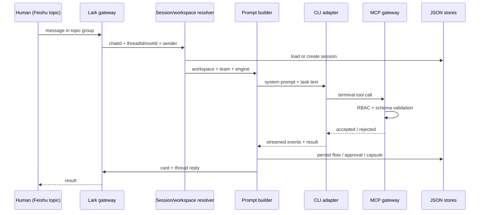
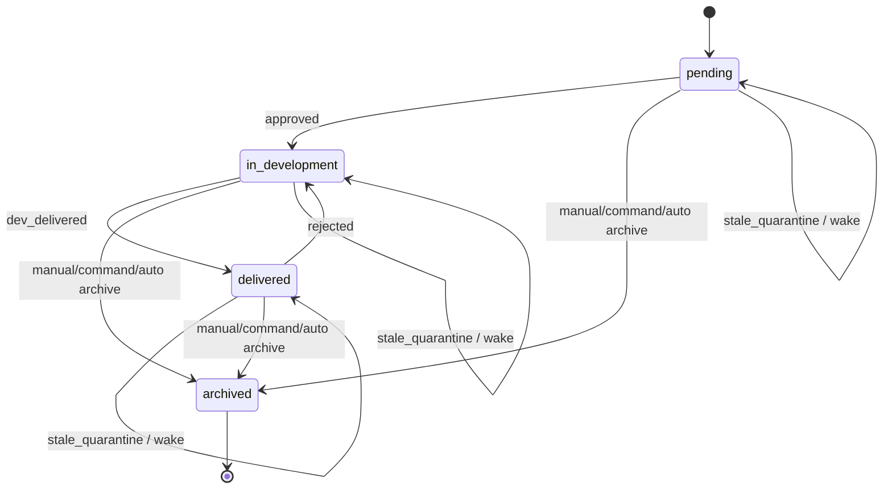

# Architecture

This document describes the public, single-team edition of HarnessOS (`v0.1.0`). It is a map of the runtime, the state machines, and the safety boundaries. It intentionally does not describe private integrations or the author's personal deployment.

## 1. Scope

HarnessOS is a **thin control plane** around existing coding CLIs. It does not implement an LLM loop, a model runtime, or a sandbox. It provides:

- A Feishu/Lark long-connection gateway.
- Topic → session → workspace routing.
- Prompt assembly with a static prefix and a just-in-time workspace probe.
- CLI adapters for Claude Code and Codex.
- An MCP tool gateway for terminal control tools.
- Deterministic gates and human-in-the-loop cards.
- JSON persistence for sessions, flows, approvals, schedules, and capsules.

The public edition is single-team: one fixed roster of bots registered in `config/bots.json`.

## 2. Design principles

1. **Thin host, fat CLI.** The host routes and gates; the CLI does the reasoning and editing.
2. **Deterministic gates before execution.** A gate that only reports damage after it happens is an incident report, not a gate.
3. **Single source of truth.** RBAC, lifecycle transitions, and workspace metadata each have one authoritative implementation.
4. **Physical isolation.** A topic owns a session; a session owns a workspace; a workspace has a lock.
5. **Fail-closed.** Missing credentials, unknown roles, and invalid transitions are rejected, not guessed.
6. **No absolute paths in agent-visible contracts.** Workspace aliases and relative paths keep prompts portable.
7. **Failure-first engineering.** Every non-trivial fix is expected to leave a regression test and a lesson.

## 3. Component map

| Layer | Main modules | Responsibility |
|---|---|---|
| IM gateway | `src/im/lark.ts`, `src/im/card.ts`, `src/im/message-parser.ts` | Long connection, event dispatch, card rendering, mention/resource parsing |
| Application | `src/app/*` | Runners, collaboration service, scheduler, lifecycle sweeps, card actions |
| Core domain | `src/core/*` | Sessions, workspaces, product specs, approvals, arbitration, capsules, RBAC, locks, runaway detection |
| CLI adapters | `src/cli/*` | Claude Code / Codex process management, stream parsing, terminal-tool extraction, MCP wiring |
| MCP gateway | `src/mcp/app-tools-server.ts` | Exposes terminal control tools to the CLI with RBAC checks |
| Persistence | `src/core/*-store.ts`, `data/*.json` | JSON stores for sessions, flows, approvals, schedules, capsule log |
| Entrypoint | `src/index.ts` | Wires the runtime, starts bots, handles messages and card actions |
| Helper CLI | `src/deploy-cli.ts` | `doctor`, `start`, `stop`, scratch commands |

## 4. Message flow

Important details:

- **Topic identity.** `threadId || rootId || messageId` identifies the topic. `topicTaskId` hashes the topic identity into a stable task id; task-scoped flows also carry the original human message id as a credential so two tasks in the same topic do not get welded together.
- **Workspace resolution.** The session's workspace can be set by `/workspace`, `/mount`, the bot's default, or a collaboration dispatch. Switching workspace resets the CLI session id (cold teardown).
- **Prompt assembly.** The static prefix contains the L0 methodology axioms. The dynamic suffix contains the task, team roster, workspace asset probe, and any collaboration capsule. Keeping the static prefix stable protects KV-cache reuse.
- **Terminal tools.** Tools such as `dispatch_task`, `request_clarification`, `request_spec_approval`, `request_approval`, `request_escalation`, `submit_tech_review`, `relay_to_peer`, `submit_arbitration_verdict`, and `schedule_manage` terminate or transition a flow. The host stops the CLI process when one is successfully called and hands control to the corresponding card/state machine.

## 5. Sessions and workspaces

- `SessionManager` stores one session per `(chatId, topicId, botId, cliId)` and persists the CLI session id per engine.
- `WorkspaceResolver` resolves an alias or path against configured workspaces and trusted roots. Directory traversal is rejected.
- `WorkspaceLockManager` provides a read/write lock with queueing, heartbeat, adaptive extension, and a maximum renewal count. Read-only recon takes a read lock; normal work takes a write lock.
- `GitWorktreeManager` can isolate a task in a git worktree when the workspace is a git repository.
- `WorkspaceChangeProbe` reads a content-level fingerprint (`git diff HEAD` hash) and compares it to the baseline captured **after** the lock is acquired.

## 6. Prompt assembly

The prompt has three parts:

1. **L0 axioms** — a stable prefix of methodology principles. It is identical across runs to preserve KV-cache reuse.
2. **Team context** — the registered bots, their roles, and their skills. The leader is the only role allowed to call `dispatch_task`; `targetBotId` must be another registered member.
3. **Workspace probe** — a small, deterministic list of assets present in the workspace (`README.md`, `docs/ARCHITECTURE.md`, `CLAUDE.md`, `package.json`, `.scratch/`). This is a token-cheap alternative to scanning the repository in the prompt.

The task text follows these sections. Collaboration tasks add a status block (hop count, dialectic round, remaining budget) and an optional context capsule.

## 7. Gates and safety boundaries

### 7.1 RBAC

`src/core/tool-rbac.ts` is the single source of role → terminal-tool permission. Both the MCP server and the host call it. A tool that is denied by the MCP layer must also be denied by the host; otherwise a failed/visible call becomes an unguarded execution path.

### 7.2 Read-only recon

A recon task gets:

- A read lock on the workspace.
- `Write`, `Edit`, `MultiEdit`, and `NotebookEdit` in the CLI stop list.
- A content-level fingerprint captured after the lock is acquired.
- A post-execution comparison as a fallback.

The declaration `intent: 'recon'` only selects the branch. The facts (stop list, lock mode, fingerprint) decide whether the result is accepted. This separation is deliberate: a model can write "read-only" in prose, but it cannot remove a tool from the stop list.

### 7.3 Approval

`request_approval` creates a pending approval flow and a Feishu card. The default timeout is 300 seconds (request range 60–3,600). A timeout is fail-safe: the operation is rejected. Approval covers irreversible operations such as killing external services, recursive deletion, force-push/reset, and destructive database changes.

### 7.4 Collaboration bounds

Three independent limits prevent runaway collaboration:

- **Chain hops** (`collaborationMaxRounds`, default 16, per-bot range 1–32): total hops in one chain. Hitting it terminates the chain.
- **Dialectic rounds** (`NEGOTIATION_MAX_ROUNDS`, default 3): product ↔ developer rounds on the same spec. Hitting it enters arbitration.
- **Dynamic escalations** (`MAX_TASK_ESCALATIONS`, default 2): tier upgrades before the chain is circuit-broken to arbitration.

They are intentionally separate: one counts how far the chain has traveled, one counts how many times two roles have argued about the same spec, and one counts how many times the task was escalated.

### 7.5 Runaway detection

`RunawayDetector` normalizes volatile tokens (timestamps, durations, ids, absolute paths, line numbers) before hashing a tool invocation. It looks at periods 1–3 in a 24-entry sliding window:

- Period 1: warning at 2, critical at 3, breaker at 3.
- Period 2–3: warning at 2, critical at 3, breaker at 4.

A breaker only fires when the cycle contains a failure; otherwise it is downgraded to critical. The intent is to stop repeated failing loops, not to punish idempotent reads.

## 8. State machines

### 8.1 Product spec lifecycle

`nextLifecycle` is a pure function over the transition table. `planLifecycleSweep` is a pure decision function that only says `none`, `quarantine`, or `archive`; the three archive channels (human click, `/archive` command, 14-day auto) share one implementation.

### 8.2 Clarification, approval, technical review, arbitration

- **Clarification**: a `request_clarification` tool call creates a clarification flow; the card collects answers and resumes the task. Only product-like roles with the appropriate skill/capability may create one.
- **Approval**: a `request_approval` call creates a pending flow; the card approves or rejects; a timeout rejects.
- **Technical review**: after a spec is submitted, a developer performs a Phase 3 feasibility review. The review flow has its own dialectic round budget and an idle TTL (6 hours). If it does not converge, it enters arbitration.
- **Arbitration**: the leader may issue a preliminary verdict (30-minute TTL) when the dispute is within its authority; otherwise it abstains. The human is the final arbiter. A 24-hour suspension window preserves the narrative; a timeout may auto-adopt a low-risk preliminary verdict only when both the leader's self-assessment and the probe facts agree.

## 9. Persistence

State lives under `data/` as JSON files. The main stores are:

- `sessions.json`
- `product-spec-flows.json`
- `approval-flows.json`
- `arbitration-flows.json`
- `tech-review-flows.json`
- `schedules.json` and `schedule-runs.json`
- `capsule-log.json`
- `experience-candidates.json`

Persistence is intentionally simple: the target is a single-user, single-host deployment. The stores are schema-validated; interface ↔ schema field parity is a hard requirement because zod strips undeclared keys.

## 10. Scheduling

`Scheduler` supports:

- `once` with a 5-minute grace window.
- `interval` with a 60-second to 24-hour range.
- `cron` with a default `Asia/Shanghai` timezone and a 100-character expression limit.

A local HTTP API (`SCHEDULE_API_PORT`, default 3101) exposes list/create/manage endpoints. Set `SCHEDULE_API_TOKEN` to require a bearer token. The MCP `schedule_manage` tool calls this API so the CLI never talks to the scheduler directly.

## 11. Context capsules and lineage

A collaboration dispatch can include a context capsule:

- Objective and tier.
- Workspace transition (alias names, not absolute paths).
- Approved spec pointer.
- Distilled decisions summary.
- Constraints.
- Optional lineage.

The capsule is bounded to 2,000 characters (constraints section 600). The capsule log records both **dispatch** and **consume** nodes with `nodeId`/`parentNodeId` and the original human message credential. That makes it possible to answer "which hop introduced this conclusion?" rather than only "what was sent at each hop?"

## 12. Extension points

- **New CLI engine**: implement the `CliAdapter` interface in `src/cli/` and register it in `src/cli/registry.ts`.
- **New IM adapter**: keep the `Bot` interface and replace `src/im/lark.ts`; the application layer talks to `Bot`, not to the Lark SDK directly.
- **New terminal tool**: add the tool name to `src/cli/app-tools.ts`, register it in the MCP server, add RBAC in `src/core/tool-rbac.ts`, and handle it in `src/index.ts` with an explicit state transition.
- **New workspace metadata**: extend `WorkspaceMetadata` and the workspace resolver; update the capsule formatter and tests.
- **New skill**: add it under `.agents/skills/<name>/SKILL.md` and list it in `config/bots.json`.

## 13. Known limitations

- Single team; no multi-team orchestration in this edition.
- Feishu/Lark only.
- Single host; JSON persistence; no horizontal scaling.
- No OS-level sandbox; prompt injection and CLI misuse are controlled by RBAC, stop lists, approvals, and workspace locks, not by kernel isolation.
- External CLI accounts are required.
- The optional Feishu Docs/Wiki path depends on `lark-cli` and the `lark-*` skills, which are not bundled.

## 14. Source map

| Topic | Files |
|---|---|
| Entrypoint / message loop | `src/index.ts` |
| Feishu gateway / cards | `src/im/lark.ts`, `src/im/card.ts`, `src/im/message-parser.ts` |
| Session / workspace | `src/core/session-manager.ts`, `src/core/session-store.ts`, `src/core/workspace-resolver.ts`, `src/core/workspace-lock-manager.ts` |
| Product spec / lifecycle | `src/core/product-spec.ts`, `src/core/product-spec-store.ts`, `src/app/lifecycle-runner.ts` |
| Collaboration | `src/core/collaboration.ts`, `src/app/collaboration-service.ts`, `src/core/capsule-lineage.ts` |
| Approval / arbitration / review | `src/core/approval.ts`, `src/core/arbitration-store.ts`, `src/app/arbitration-runner.ts`, `src/core/tech-review-store.ts` |
| CLI / MCP | `src/cli/*`, `src/mcp/app-tools-server.ts` |
| RBAC / gates | `src/core/tool-rbac.ts`, `src/app/recon-guard.ts`, `src/core/high-risk-guard.ts`, `src/core/runaway-detector.ts` |
| Scheduling | `src/core/schedule.ts`, `src/app/scheduler.ts`, `src/app/schedule-api.ts` |
| Scratch lifecycle | `src/app/scratch-cli.ts`, `src/app/scratch-survey.ts`, `src/app/scratch-archiver.ts` |
